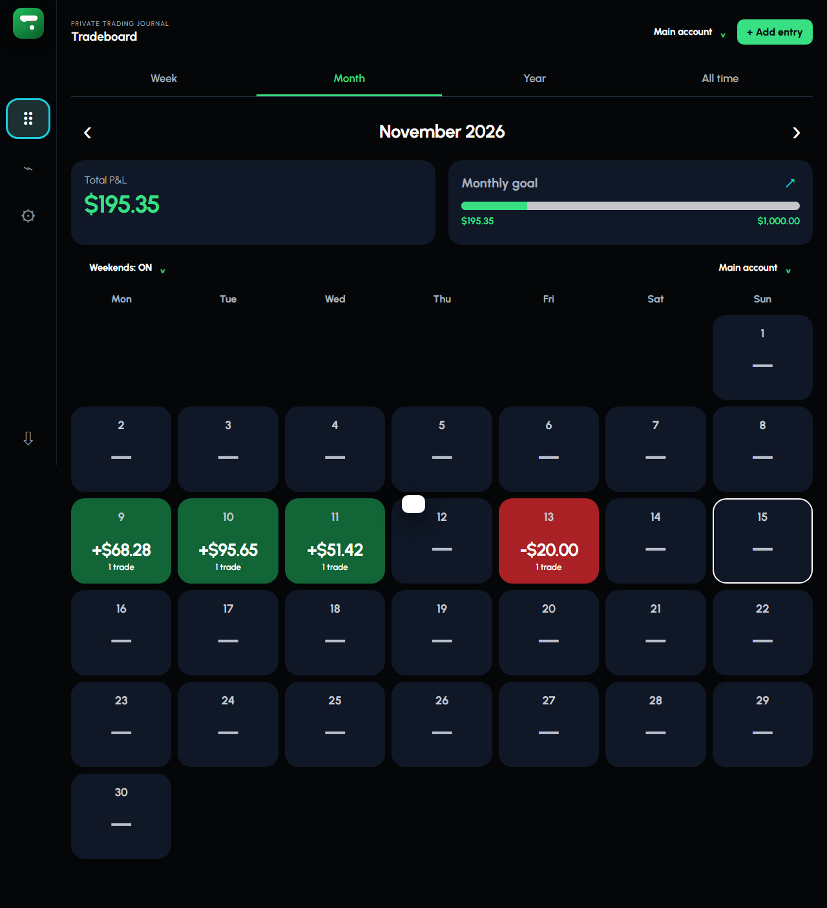

# Tradeboard

Tradeboard is an original, browser-first trading journal. It makes daily P&L review feel like a focused product workflow: log a day, see the calendar state, and inspect the pattern behind the result.



## What you get

- A calendar-first journal with positive, negative, empty, and selected daily states.
- Week, month, year, and all-time views with date navigation.
- Local trade-entry flow with P&L, trade count, setup, and reflection fields.
- Performance review: profit/loss split, win rate, profit factor, expectancy, and quick stats.
- Privacy mode, trade-count control, weekday-only option, goal editing, demo restore, and JSON export.
- Responsive navigation: desktop icon rail and a compact mobile bottom bar.

## Benefits

Tradeboard keeps the review loop short. The calendar exposes consistency at a glance, local persistence lets a user try the workflow without an account, and JSON export keeps journal data portable. The analytics are designed to turn daily outcomes into actionable review prompts rather than financial advice.

## Tech stack

| Layer | Technology | Purpose |
| --- | --- | --- |
| UI | HTML5 | Semantic structure, accessible controls, and native dialog. |
| Styling | CSS3 | Responsive desktop/mobile layouts, visual states, and dark product UI. |
| Application | Vanilla JavaScript (ES2022) | State, calculations, navigation, rendering, and interactions. |
| Persistence | `localStorage` | Browser-local journal data and preferences. |
| Verification | Node syntax check + Playwright/Chrome screenshot | Fast implementation checks and visual review. |

## Run locally

Requirements: Node.js 22+.

```bash
npm run check
npm start
```

Open the local URL printed by `serve`.

## Local data model

```json
{
  "date": "2026-11-10",
  "pnl": 95.65,
  "count": 1,
  "tag": "Pullback",
  "note": "Followed the plan and managed risk."
}
```

## Project boundaries

Tradeboard is an independent implementation. Its product direction was informed by high-level, user-authorized REA observations recorded in [docs/REA_AUTH_FINDINGS.md](docs/REA_AUTH_FINDINGS.md); it does not include third-party code, credentials, data, screenshots, or brand assets.

## Next steps

- Optional cloud sync and sign-in.
- Multiple accounts and currencies.
- CSV imports and broker-specific reporting.
- Automated browser interaction tests.

Trading metrics are for review and record-keeping only, not financial advice.
