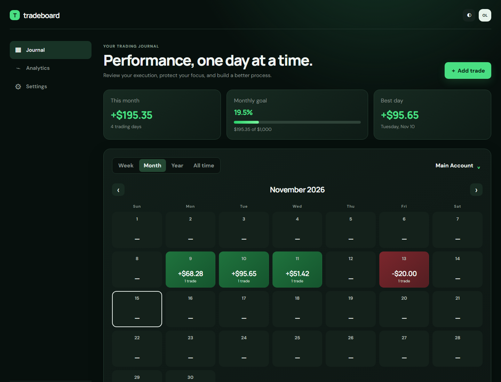

# Tradeboard

Tradeboard is a focused, browser-first trading journal for recording daily P&L, spotting performance patterns, and reflecting on execution. It is an original web interface inspired by the workflow of a calendar-based trading journal—not a copy of a third-party application or brand.



## Why Tradeboard

Many traders know their P&L but lose the context behind it. Tradeboard puts the important information in one calm workspace:

- Log a trading day with P&L, trade count, setup, and reflection.
- See profitable and losing days instantly in a calendar.
- Switch between week, month, year, and all-time performance views.
- Use win rate, profit factor, expectancy, and daily P&L to review habits—not just results.
- Keep data private in the browser and export it as JSON whenever needed.

## Features

| Area | Included capability |
| --- | --- |
| Journal | Add, replace, and review daily trading entries with notes and setup tags. |
| Calendar | Week, month, year, and all-time perspectives with positive/negative P&L states. |
| Analytics | Net P&L, expectancy, win rate, profit factor, and a compact daily P&L chart. |
| Preferences | Toggle trade counts, weekday-only calendar view, and P&L privacy blur. |
| Data ownership | Local browser storage and a one-click JSON export. |
| Responsive UI | Purpose-built desktop workspace and compact mobile navigation. |

## Tech Stack

- **HTML5** for accessible document structure and native dialogs.
- **CSS3** for a responsive, dark trading dashboard, fluid layouts, and visual states.
- **Vanilla JavaScript (ES2022)** for journal state, local persistence, calculations, and UI interactions.
- **localStorage** for browser-local persistence—no account or server is required to try the prototype.
- **Playwright/Chrome** for local visual verification and the README screenshot.

## Run locally

Prerequisites: Node.js 22+.

```bash
npm run check
npm start
```

Then visit [http://localhost:4173](http://localhost:4173).

## Data model

Each journal entry is stored locally with the following shape:

```json
{
  "date": "2026-11-10",
  "pnl": 95.65,
  "count": 1,
  "tag": "Pullback",
  "note": "Followed the plan and managed risk."
}
```

## Roadmap

- Supabase authentication and per-user cloud sync.
- Multiple trading accounts and currencies.
- CSV broker import and richer trade-level metrics.
- Data import, server-side exports, and PDF reports.
- Automated tests for calculation and calendar edge cases.

## Verification

`npm run check` validates the application JavaScript syntax. The current UI was additionally served locally and visually inspected in Chrome at desktop size.

---

Built as an original educational trading-journal prototype. Trading metrics are for review and record-keeping only; they are not financial advice.
